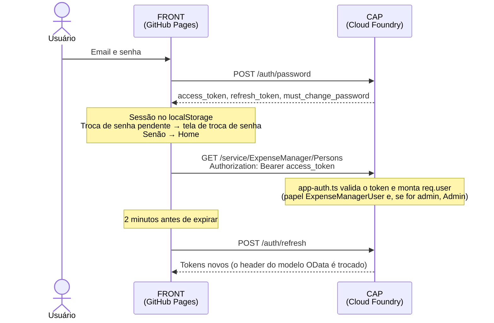

# Fluxo de Autenticação — Expense Manager App (GitHub Pages + CAP)

O app tem login próprio: os usuários ficam na tabela `Users` do CAP (não exposta em nenhum serviço) e os tokens são emitidos pelo próprio CAP. Não há XSUAA, approuter nem redirecionamento para outra página: todas as chamadas são `fetch` a partir do GitHub Pages.

## Rotas `/auth`

| Rota | Corpo | Resposta |
|---|---|---|
| `POST /auth/password` | `{ username, password }` | Tokens + `user_name`, `name`, `role`, `must_change_password` |
| `POST /auth/refresh` | `{ refresh_token }` | Tokens novos |
| `POST /auth/change-password` | `{ current_password, new_password }` + `Authorization: Bearer` | Tokens novos (os anteriores deixam de valer) |
| `GET /auth/me` | `Authorization: Bearer` | Perfil do usuário |
| `POST /auth/signup` | `{ email, name, password, lang }` | `202 { status: "confirmation_sent" \| "pending_approval" }` |
| `POST /auth/confirm` | `{ token }` | Tokens (a conta é ativada e o usuário já entra) |
| `POST /auth/forgot-password` | `{ email, lang }` | Sempre `202` |
| `POST /auth/reset-password` | `{ token, new_password }` | Tokens novos (os anteriores deixam de valer) |

Erros: `401 invalid_credentials`, `401 invalid_token`, `403 account_pending`, `403 account_disabled`, `400 weak_password` (mínimo de 8 caracteres), `400 invalid_email`, `400 invalid_name`, `400 invalid_link` e `429 too_many_attempts` (10 tentativas por IP a cada 15 minutos; `AUTH_RATE_LIMIT` muda o limite).

## Criar conta, confirmar e redefinir a senha

- **Criar conta:** com servidor de email (`SMTP_*`), a conta nasce `Pending` e recebe um link de confirmação válido por 48 horas (`#/confirm-email/{token}`). Sem servidor de email, a conta nasce `Pending` e espera a aprovação de um admin. Em desenvolvimento local, sem SMTP, o email é escrito no log do CAP.
- **Mesma resposta para qualquer email:** cadastrar um email já existente responde igual a um cadastro novo. Se a conta estiver pendente, o link de confirmação é reenviado; se estiver ativa, o dono recebe um aviso de que alguém tentou cadastrar o email dele. Assim a tela não revela quem tem conta.
- **Esqueci a senha:** sempre responde `202`. Só contas ativas recebem o link, que vale por 1 hora (`#/reset-password/{token}`). Isso também serve para os usuários criados sem senha a partir dos dados existentes.
- **Links:** o token aleatório só existe no email; a tabela guarda o hash SHA-256 dele. Cada link é de uso único, e pedir um novo invalida o anterior. Redefinir a senha incrementa a versão do token, derrubando as sessões antigas.
- **Endereço dos links:** `APP_URL` (padrão `https://expensemanagerapp.github.io/`).
- Os emails têm parte HTML e texto, em português ou inglês conforme o idioma do navegador.

## Tokens

- JWT HS256 assinado com uma chave derivada de `SETTINGS_SECRET`.
- Access token de 1 hora; refresh token de 30 dias.
- Os dois carregam a versão do token do usuário (`Users.TokenVersion`). Trocar a senha ou desativar a conta incrementa a versão e invalida todos os tokens emitidos antes.
- A senha é guardada só como hash scrypt e nunca aparece no log.

## Sequência

## Autorização

- `req.user.id` é o email do usuário. Ele é comparado com `Persons.createdBy` (dono) e `Shares.User` (compartilhamento), então os dados existentes continuam com o mesmo dono.
- Todo usuário ativo recebe o papel `ExpenseManagerUser`, exigido pelos serviços; administradores recebem também `Admin`.
- Quem ainda precisa trocar a senha não recebe papel nenhum: só as rotas `/auth` respondem até a troca.
- Em desenvolvimento (fora do Cloud Foundry) os serviços também aceitam Basic com email e senha da tabela `Users`, para scripts e testes.

## Usuários na subida

`UserBootstrap` roda a cada start e só preenche o que falta:

- cria o administrador de `ADMIN_EMAIL` / `ADMIN_PASSWORD`;
- cria um usuário sem senha (com troca obrigatória) para cada dono e destinatário de compartilhamento dos dados existentes.

## Front-end

| Arquivo | Papel |
|---|---|
| `webapp/auth/AuthApi.ts` | Chama as rotas `/auth` e monta a sessão |
| `webapp/auth/AuthenticationService.ts` | Guarda a sessão, renova o token antes de expirar e avisa o `Component` |
| `webapp/routing/AppRouter.ts` | Guard das rotas antes de exibir as views (login, troca de senha) |
| `webapp/controller/ChangePassword.controller.ts` | Troca de senha obrigatória |

## Arquivos do CAP

| Arquivo | Papel |
|---|---|
| `srv/auth/authRouter.ts` | Rotas `/auth` e limite de tentativas |
| `srv/auth/AuthService.ts` | Login, refresh, troca de senha e usuário do token |
| `srv/auth/AccountService.ts` / `AccountMails.ts` | Criar conta, confirmação, esqueci a senha e os emails desses fluxos |
| `srv/infrastructure/Mailer.ts` | Envio pelo SMTP das variáveis `SMTP_*` (no desenvolvimento, sem SMTP, escreve no log) |
| `srv/auth/app-auth.ts` | Autenticação `custom` do CAP (`cds.requires.auth.impl`) |
| `srv/auth/TokenService.ts` / `PasswordHasher.ts` | JWT HS256 e hash scrypt |
| `srv/auth/UserBootstrap.ts` | Administrador inicial e usuários dos dados existentes |
| `srv/middlewares/cors.ts` | Libera o origin `https://expensemanagerapp.github.io` |
